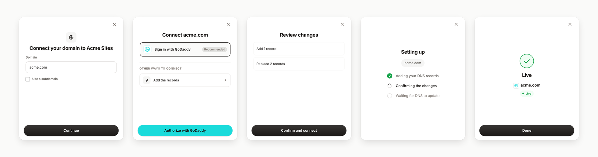
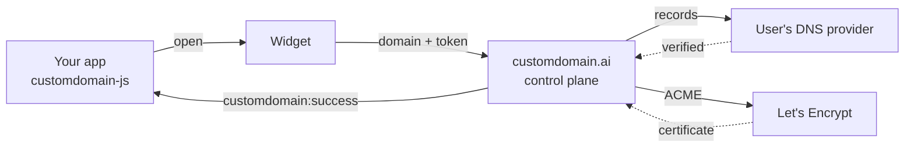

<p align="center"><picture><source media="(prefers-color-scheme: dark)" srcset=".github/media/customdomain-mark-dark.png"></picture></p>
<h1 align="center">CustomDomain SDK</h1>
<p align="center"><b>The JavaScript and React SDK that opens the CustomDomain™ widget in your app, so your users connect their own domain.</b></p>
<p align="center"><a href="https://www.npmjs.com/package/customdomain-js"></a> <a href="https://www.npmjs.com/package/@customdomain/react"></a> <a href="https://github.com/CUSTOM-DOMAIN-APP/customdomain-sdk/actions/workflows/ci.yml"></a> <a href="https://docs.customdomain.ai/docs/widget-sdk/overview"></a> <a href="https://www.producthunt.com/products/custom-domain"></a></p>
<p align="center"><picture><source media="(prefers-color-scheme: dark)" srcset=".github/media/widget-flow-dark.png"></picture></p>

[Website](https://customdomain.ai) · [Docs](https://docs.customdomain.ai/docs) · [Console](https://app.customdomain.ai) · [Widget and SDK reference](https://docs.customdomain.ai/docs/widget-sdk/reference) · [Releases](https://github.com/CUSTOM-DOMAIN-APP/customdomain-sdk/releases) · [Changelog](./CHANGELOG.md)

|  |  |
|---|---|
| **What it is** | Browser SDK and React bindings for the CustomDomain™ connect flow |
| **Who it's for** | SaaS teams whose users want `acme.com`, not `acme.yourapp.com` |
| **Live at** | [customdomain.ai](https://customdomain.ai) · docs at [docs.customdomain.ai/docs](https://docs.customdomain.ai/docs) |
| **Stack** | TypeScript · pnpm workspace · `customdomain-js` ships zero runtime dependencies |

This repository is the client half of [CustomDomain™](https://customdomain.ai): two npm packages
your application installs, plus the widget they open. Your app calls one function; the user pastes
a domain; DNS records, ownership verification and TLS certificates are handled for you.

## Why this exists

Letting customers bring their own domain is one of the highest-leverage features a SaaS product
can ship: it is what turns "powered by us" into the customer's own brand. It is also a swamp.
Every DNS provider exposes a different write API, or none. Root domains cannot hold a `CNAME`
([RFC 1034](https://datatracker.ietf.org/doc/html/rfc1034)), so half the internet's advice is
wrong for half of your users. Certificates have to be issued on demand and renewed forever. And
the failure mode is not an exception in your logs; it is a support ticket that says
"it still says pending."

CustomDomain™ turns that into a payment-method-shaped interaction: paste the domain, and either
the provider is authorized in one click or the widget shows the exact records and watches for
them.

## Install

|  | Package | Install |
|---|---|---|
| <picture><source media="(prefers-color-scheme: dark)" srcset="https://cdn.simpleicons.org/npm/e7e5e4"></picture> | `customdomain-js`, framework agnostic | `npm install customdomain-js` |
| <picture><source media="(prefers-color-scheme: dark)" srcset="https://cdn.simpleicons.org/react/e7e5e4"></picture> | `@customdomain/react`, hooks and components | `npm install @customdomain/react` |

Or skip the build step entirely and load the hosted bundle, which is always current:

```html
<script src="https://app.customdomain.ai/widget-assets/customdomain-sdk.js"></script>
```

## Quickstart

```js
import { customdomain } from "customdomain-js";

customdomain.open({
  applicationId: "app_123",
  token: TOKEN_FROM_YOUR_SERVER, // minted server side; never ship an API key to the browser
  getToken: fetchFreshTokenFromYourServer, // optional: keeps long manual setups alive
});

window.addEventListener("customdomain:success", (e) => {
  console.log("connected:", e.detail.domain); // e.g. "acme.com"
});
```

`getToken` can also be how the widget asks for a token for the domain the user typed. When the widget
sends the domain and a reason, `getToken` is called with `{ domain, reason }`: `reason` is `"expired"`
for a token that ran out and `"bind"` when the token in use is not bound to `domain`. Mint the new
token for that domain and for your own user (`domain` and `end_user_ref` on `POST /v1/tokens`), and
the secure sign-in is accepted for it. The hosted widget does not send them yet: until it does,
`getToken` is called with `{ reason: "expired" }`. A `getToken` with no parameter keeps working. See
[Tokens for the domain the user typed](packages/sdk/README.md#tokens-for-the-domain-the-user-typed).

## Framework guides

Every guide below has the same two halves. Your server holds the API key and mints a widget token that lasts
15 minutes; the browser asks your server for one and passes it to the widget. The browser never sees the API
key. Exact token options and errors are in
[Installation and embed](https://docs.customdomain.ai/docs/widget-sdk/installation-and-embed).

### <picture><source media="(prefers-color-scheme: dark)" srcset="https://cdn.simpleicons.org/nextdotjs/e7e5e4"></picture> Next.js

A route handler mints the token. Keep `CUSTOMDOMAIN_API_KEY` in the server environment, and check that the
caller is signed in before you answer:

```ts
// app/api/customdomain-token/route.ts
export async function POST(req: Request) {
  // Check your own session here: only signed-in users should get a token.
  // When the widget names the domain the user typed, bind the token to it.
  const body = await req.json().catch(() => ({}));
  const domain = typeof body?.domain === "string" ? body.domain : undefined;
  const res = await fetch("https://app.customdomain.ai/api/widget-token", {
    method: "POST",
    headers: {
      Authorization: `Bearer ${process.env.CUSTOMDOMAIN_API_KEY}`,
      "Content-Type": "application/json",
    },
    body: JSON.stringify({ domain }), // optional: { application_id, domain }
  });
  if (!res.ok) return Response.json({ error: "token_failed" }, { status: 502 });
  const { application_id, token } = await res.json();
  return Response.json({ application_id, token });
}
```

The button is a client component. `@customdomain/react` touches `window` only inside effects, so the page
around it can render on the server:

```tsx
// app/settings/domain/connect-domain-button.tsx
"use client";

import { useCustomdomain } from "@customdomain/react";

async function fetchToken(domain?: string): Promise<{ application_id: string; token: string }> {
  const res = await fetch("/api/customdomain-token", {
    method: "POST",
    headers: { "Content-Type": "application/json" },
    body: JSON.stringify({ domain }),
  });
  if (!res.ok) throw new Error("Could not get a widget token");
  return res.json();
}

export function ConnectDomainButton({ applicationId, userId }: { applicationId: string; userId: string }) {
  const { open, ready } = useCustomdomain({
    applicationId,
    token: "", // open() below passes a fresh one
    // Keeps long manual setups alive, and binds the token to the domain when the widget names one:
    getToken: async (ctx) => (await fetchToken(ctx?.domain)).token,
    endUserRef: userId,
    onSuccess: ({ domain }) => console.log(`${domain} connected`),
  });

  return (
    <button disabled={!ready} onClick={async () => open({ token: (await fetchToken()).token })}>
      Connect your domain
    </button>
  );
}
```

### <picture><source media="(prefers-color-scheme: dark)" srcset="https://cdn.simpleicons.org/react/e7e5e4"></picture> React

Any React app (Vite, Remix, Create React App) uses the same package. `<CustomdomainConnect>` opens the flow
when it mounts and closes it when it unmounts or `open` turns `false`:

```tsx
import { useState } from "react";
import { CustomdomainConnect } from "@customdomain/react";

export function DomainSettings({ applicationId, token }: { applicationId: string; token: string }) {
  const [connecting, setConnecting] = useState(false);

  return (
    <>
      <button onClick={() => setConnecting(true)}>Connect your domain</button>
      <CustomdomainConnect
        open={connecting}
        applicationId={applicationId}
        token={token} // minted by your server
        onSuccess={(r) => console.log("connected", r.domain)}
        onClose={() => setConnecting(false)}
      />
    </>
  );
}
```

### <picture><source media="(prefers-color-scheme: dark)" srcset="https://cdn.simpleicons.org/vuedotjs/e7e5e4"></picture> Vue

Vue uses `customdomain-js` directly. Callbacks passed to `open()` arrive in addition to the `customdomain:*`
window events:

```vue
<script setup lang="ts">
import { onBeforeUnmount } from "vue";
import { customdomain } from "customdomain-js";

const props = defineProps<{ userId: string }>();
const emit = defineEmits<{ connected: [domain: string] }>();

async function fetchToken(domain?: string): Promise<{ application_id: string; token: string }> {
  const res = await fetch("/api/customdomain-token", {
    method: "POST",
    headers: { "Content-Type": "application/json" },
    body: JSON.stringify({ domain }),
  });
  if (!res.ok) throw new Error("Could not get a widget token");
  return res.json();
}

async function connect() {
  const { application_id, token } = await fetchToken();
  customdomain.open({
    applicationId: application_id,
    token,
    getToken: async (ctx) => (await fetchToken(ctx?.domain)).token,
    endUserRef: props.userId,
    onSuccess: ({ domain }) => emit("connected", domain),
  });
}

onBeforeUnmount(() => customdomain.close());
</script>

<template>
  <button @click="connect">Connect your domain</button>
</template>
```

### Setup state for any framework (0.6)

`customdomain-js/store` keeps where a setup stands (`idle`, `open`, `success`, `error`, `closed`, with the last
step, result, error, fallback and removal) from the widget's events. Pass `store.bind(config)` to `open()`; your
own callbacks still run.

```ts
import { customdomain } from "customdomain-js";
import { createSetupStore } from "customdomain-js/store";

const store = createSetupStore();
customdomain.open(store.bind({ applicationId, token }));
store.subscribe(() => console.log(store.getSnapshot().phase));
```

- **React:** `useSetupState(store)` from `@customdomain/react`.
- **Vue:** `useSetupState(store)` from `customdomain-js/vue` returns a ref (vue 3.3 or newer).
- **Svelte:** `toReadable(store)` from `customdomain-js/svelte` is a readable store: `$setup.phase`.
- **Tests:** `simulateSetup(config, outcome, { domain })` from `customdomain-js/testing` plays a success, error,
  fallback or cancel into your callbacks with no iframe and no network.

### Plain script tag

No build step: the hosted bundle attaches `window.customdomain`.

```html
<button id="connect-domain">Connect your domain</button>
<script src="https://app.customdomain.ai/widget-assets/customdomain-sdk.js"></script>
<script>
  document.getElementById("connect-domain").addEventListener("click", async () => {
    const res = await fetch("/api/customdomain-token", { method: "POST" });
    const { application_id, token } = await res.json();
    window.customdomain.open({ applicationId: application_id, token });
  });

  window.addEventListener("customdomain:success", (e) => {
    console.log("connected:", e.detail.domain);
  });
</script>
```

## What it does

- **Opens the connect widget.** `customdomain.open(config)` mounts it in a sandboxed iframe, themed and localized.
- **Detects the provider and writes the records.** One-click authorization, a scoped provider API token, or [Domain Connect](https://www.domainconnect.org), with a guided manual path as the fallback.
- **Verifies ownership without a separate challenge step.** Control is proven by the rail that writes the DNS, or by the records appearing in authoritative DNS.
- **Handles root domains.** `wwwRedirect` connects the root and `www` and redirects the root, connects the root alone, or lets the user choose.
- **Streams progress to your app.** `customdomain:success`, `:step`, `:close`, `:error`, `:fallback`, `:purchase`, `:removed` and `:shared` events, plus `checkDomain()` and `checkRecords()` if you want to drive your own UI.
- **White-labels.** Colors, fonts, copy, locale and logo, so the flow reads as part of your product.

## How it's organized

```text
.
├── packages/sdk/         # customdomain-js: window.customdomain, framework agnostic
├── packages/react/       # @customdomain/react: hooks and components over the SDK
├── packages/widget/      # the widget UI used by CI's browser simulation (private, never published)
├── scripts/              # verify-release.sh (npm serves what this repo says) · release-notes.sh
├── llms.txt              # machine-readable index of this repo, for agents
└── .github/workflows/    # ci · release (tag driven, npm provenance) · sdk-drift (weekly)
```

Entry point: [`packages/sdk/src/index.ts`](packages/sdk/src/index.ts). Per-package APIs:
[`packages/sdk/README.md`](packages/sdk/README.md) · [`packages/react/README.md`](packages/react/README.md).



The SDK never talks to a DNS provider directly. It opens the widget, the widget talks to the
control plane, and your app listens for events.

## Develop

```sh
pnpm install
pnpm -r build        # react typechecks against the SDK's generated .d.ts, so build first
pnpm -r typecheck
pnpm -r test         # runtime tests of the built SDK bundle, under node --test
pnpm sim             # drives the built widget through headless Chromium, 6 scenarios
```

CI runs all five on every pull request. The tests load the built `dist/index.js` and check what
`open()` hands the widget and what `checkDomain()` returns. The sim is a behavior gate, not a unit test: it walks
the OAuth journey, the manual fallback, locale and white-label theming, sequential multi-domain,
resume of a live domain, and share-link minting against a stub control plane with real wire shapes.

## Versioning and release

[Semantic Versioning](https://semver.org/). The two published packages move in lockstep and share
one [CHANGELOG.md](./CHANGELOG.md). Every published version has a `vX.Y.Z` tag and a
[GitHub release](https://github.com/CUSTOM-DOMAIN-APP/customdomain-sdk/releases) whose notes are
that version's CHANGELOG entry.

To release: bump both `package.json` files, add the CHANGELOG section, merge, then push a
`vX.Y.Z` tag. `release.yml` publishes both packages with npm provenance, runs
`scripts/verify-release.sh` against the live registry, and only then creates the GitHub release.
It runs only where GitHub Actions run for this repository; however the packages are published,
the release is done when `scripts/verify-release.sh` exits 0. The product monorepo then picks the
release up with its `scripts/vendor-sdk.sh X.Y.Z`; it holds no SDK source of its own. A separate weekly `sdk-drift` job compares this repo against the registry, because
a release that silently never fires produces no failing check anywhere else.

## Known limitations

- `@customdomain/widget` is `private: true` and served hosted from app.customdomain.ai. You cannot self-host that bundle, and the copy here exists for CI's browser simulation.
- 116 of the 178 catalogued providers have no usable delegated write API, so their users get the guided manual flow. Verified against `GET https://api.customdomain.ai/v1/providers/census` on 2026-10-09: 178 catalogued, 55 provider API, 6 OAuth, 1 Domain Connect, 116 manual (62 with an automatic write path).
- Widget tokens must be minted by your server. There is no browser-safe API key, by design.

## Related

- [docs](https://github.com/CUSTOM-DOMAIN-APP/docs): source of [docs.customdomain.ai](https://docs.customdomain.ai/docs)
- [customdomain-mcp](https://github.com/CUSTOM-DOMAIN-APP/customdomain-mcp): the hosted MCP server for AI agents
- [custom-domain-checks](https://github.com/CUSTOM-DOMAIN-APP/custom-domain-checks): a GitHub App for continuous DNS and TLS health checks
- [awesome-custom-domains](https://github.com/CUSTOM-DOMAIN-APP/awesome-custom-domains): the map of the whole space, including the alternatives

## Support

- **Docs:** [docs.customdomain.ai](https://docs.customdomain.ai/docs)
- **Questions and ideas:** [GitHub Discussions](https://github.com/CUSTOM-DOMAIN-APP/docs/discussions)
- **Bugs and corrections:** [open an issue](https://github.com/CUSTOM-DOMAIN-APP/customdomain-sdk/issues) on this repository
- **Service status:** [status.customdomain.ai](https://status.customdomain.ai)
- **Account and billing:** connect@customdomain.ai
- **Security:** report privately to security@customdomain.ai, never in a public issue. Policy: [app.customdomain.ai/security](https://app.customdomain.ai/security)

## License

[Apache-2.0](./LICENSE). CustomDomain™ is a product of EverJust Company.
