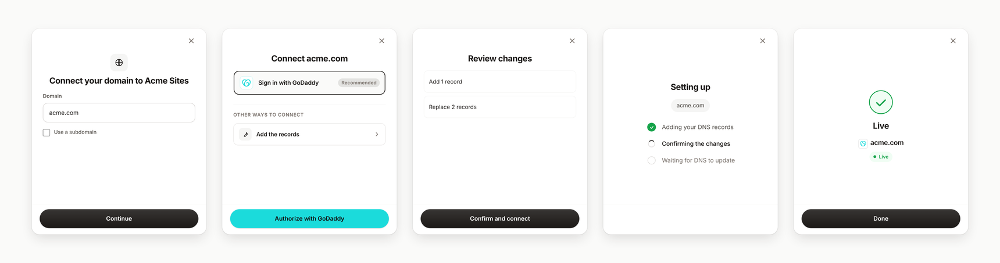

<!-- Native SDKs overview: install, five line usage, callbacks, for iOS (Swift) and Android (Kotlin). Public text: how to integrate only. -->
# CustomDomain for iOS and Android

Let your users connect their own domain inside your mobile app. The SDK shows the CustomDomain™ widget in your app and takes care of signing in at the provider and returning to your app.

<p align="center"><picture><source media="(prefers-color-scheme: dark)" srcset="../.github/media/widget-flow-dark.png"></picture></p>

Before you start, create an application in the [console](https://app.customdomain.ai) and register your app return link there. Your server mints the token; the app never holds a key.

## iOS

Requires iOS 16 or later (an https return link needs iOS 17.4 or later).

Install with Swift Package Manager: add `https://github.com/CUSTOM-DOMAIN-APP/customdomain-sdk` and pick the `CustomDomain` product, or add the folder `native/ios` as a local package.

```swift
import CustomDomain

Button("Connect your domain") { show = true }
  .customDomainSheet(isPresented: $show,
    configuration: CustomDomainConfiguration(applicationId: "app_id", returnScheme: "myapp"),
    callbacks: CustomDomainCallbacks(fetchToken: { try await api.customDomainToken() }, onSuccess: { print($0.domain) }))
  .onOpenURL { CustomDomain.handleReturn($0) }
```

## Android

Requires Android 7.0 (API 24) or later.

Include the `native/android/customdomain` module in your Gradle build (`include(":customdomain")`, then `implementation(project(":customdomain"))`).

```kotlin
CustomDomainSheet.show(supportFragmentManager,
  CustomDomainConfig(applicationId = "app_id", appReturn = "https://acme.com/cd-return"),
  CustomDomainCallbacks(fetchToken = { done -> done.onToken(mintToken()) }, onSuccess = { println(it.domain) }))
// In the activity that owns your return link:
override fun onNewIntent(intent: Intent) { super.onNewIntent(intent); CustomDomain.handleReturn(intent.dataString) }
```

Claim the return link on that activity with an intent filter (an App Link on your own domain, or a custom scheme). The sample shows one.

## Callbacks

| Callback | When it runs |
|---|---|
| `fetchToken` | The widget needs a token. Return one from your server. It runs again when the token expires. |
| `onSuccess` | The domain is connected. You get the domain and the provider. |
| `onError` | Something failed. You get a code and a message. |
| `onClose` | The person closed the widget. |

Place the widget in your own screen with `CustomDomainView` (iOS and Android) instead of the sheet.

## Samples

`native/ios/Sample` (SwiftUI) and `native/android/sample` (one activity).

## License

Apache-2.0, like the rest of this repository.
